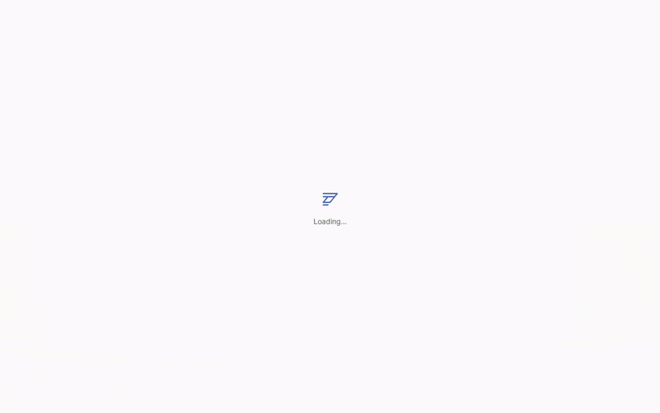

# Talaria WebUI

[](https://github.com/liamsmith86/talaria-webui/actions/workflows/ci.yml)
[](LICENSE)
[](pyproject.toml)
[](#installation)

> [!NOTE]
> Talaria WebUI is feature complete and actively maintained. Development prioritizes bug fixes, security testing, stability and performance improvements, and ongoing verification to ensure compatibility with future Hermes Agent releases. Low commit activity does not mean the project is abandoned. Opening GitHub Issues is welcome and encouraged and all will be triaged in a timely manner.

Talaria WebUI is a lightweight, performant, and secure application for chatting with your Hermes Agent. The core development principle is that Talaria WebUI should be a thin interface layer of your existing Hermes Agent. Your Hermes configuration and settings are the single source of truth for your agent and they're not subject to a third party reinterpretation.

Talaria WebUI uses Hermes Agent's [API server](https://hermes-agent.nousresearch.com/docs/user-guide/features/api-server) feature to interface with your agent and upon installation you will be prompted to enter an API key for connectivity. Accordingly, Talaria WebUI connects to your agent remotely and does not need to be installed on the same server.

Optionally you can install the Talaria Hermes Agent plugin, a lightweight extension for your Hermes Agent which extends the information returned to Talaria WebUI by the Hermes Agent API. This allows Talaria WebUI to deliver a more polished experience and support features you would expect from a modern agent web interface. This allows us to continue offloading as much functionality to Hermes Agent's existing code without reinventing the wheel ourselves.

**[Try the demo](https://talaria.everla.st)**



<details>
<summary>Mobile preview</summary>


</details>

## Installation

Talaria connects remotely to your Hermes Agent's API and does not need to be installed on the same server.

### Ask your agent (Recommended)

```text
Install Talaria WebUI using https://raw.githubusercontent.com/liamsmith86/talaria-webui/stable/install.sh
with --non-interactive --service auto --enable-hermes-api --plugin. Let setup
discover Hermes and generate the login password; check --help for other options.
Do not restart the Hermes gateway hosting this session; report any required restart.
Return the URL and password file path, not the password.
```

### Install manually

Linux, macOS, and Windows via WSL2:

```sh
curl -fsSL https://raw.githubusercontent.com/liamsmith86/talaria-webui/stable/install.sh | bash
```

Follow the prompts, then open the URL printed by the installer.

Update from Settings → Talaria. Its update channel defaults to Stable, which installs tested releases. Nightly installs each change merged to `main`, before it's released.

### Install via Docker

With [Docker](https://docs.docker.com/get-started/get-docker/) installed:

```sh
docker pull ghcr.io/liamsmith86/talaria-webui:latest
docker run -d --name talaria --restart unless-stopped \
  -p 127.0.0.1:8766:8766 -v talaria-data:/data \
  ghcr.io/liamsmith86/talaria-webui:latest
```

<details>
<summary>Build from source instead</summary>

```sh
git clone --branch stable https://github.com/liamsmith86/talaria-webui.git
cd talaria-webui
docker build -t talaria-webui .
docker run -d --name talaria --restart unless-stopped \
  -p 127.0.0.1:8766:8766 -v talaria-data:/data \
  talaria-webui
```

</details>

Open **http://127.0.0.1:8766** and retrieve the initial login password:

```sh
docker exec talaria cat /data/talaria/initial-password.txt
```

Connect to your Hermes API in Settings.

## Hermes plugin

Talaria WebUI can also use an optional, but highly recommended, plugin that you install on your Hermes Agent to extend API capabilities and improve the amount of information we can display in the web UI. As Hermes Agent developers continue to extend the capabilities of their native API we will update Talaria WebUI to use native routes.

To install the Talaria WebUI helper plugin on your Hermes agent, run the following command on your Hermes Agent's host:

```sh
hermes plugins install talaria-webui --enable &&
hermes gateway restart
```

## Features

### Chat

- Live streaming replies with inline reasoning and tool activity.
- Markdown, syntax-highlighted code, and copy controls.
- Image and text attachments.
- Stop a response or send guidance while it runs.

### Sessions

- Search sessions and jump to matching messages in full history.
- Pin, rename, branch, and delete sessions.
- Edit messages, regenerate replies, and download transcripts.
- Native Hermes `/compress` slash command support.
- Context usage, token counts, response details, and API run status.

### Interface

- Mobile and desktop layouts with a collapsible sidebar.
- Add Talaria to your home screen from your browser’s menu.
- Light and dark themes with accent colors.
- Seven interface languages with automatic language selection.
- Switch between Hermes profiles and connections.
- Per-session model and reasoning settings.
- Inline approval requests and clarification questions.

Some features require the Talaria WebUI helper plugin installed on your Hermes Agent because the native API does not currently expose this information.

## Configuration

| Setting | Where |
| --- | --- |
| Connection, login, listener, public URL | `~/.config/talaria/config.json` |
| Additional Hermes connections | `~/.config/talaria/profiles.json` |
| Command results and per-session model choices | `~/.config/talaria/config.state.db` |
| API key from an environment variable (initial profile) | `TALARIA_HERMES_API_KEY` |
| Custom configuration file | `talaria --config PATH` |

System installations use `/var/lib/talaria`; Docker uses `/data/talaria`.
